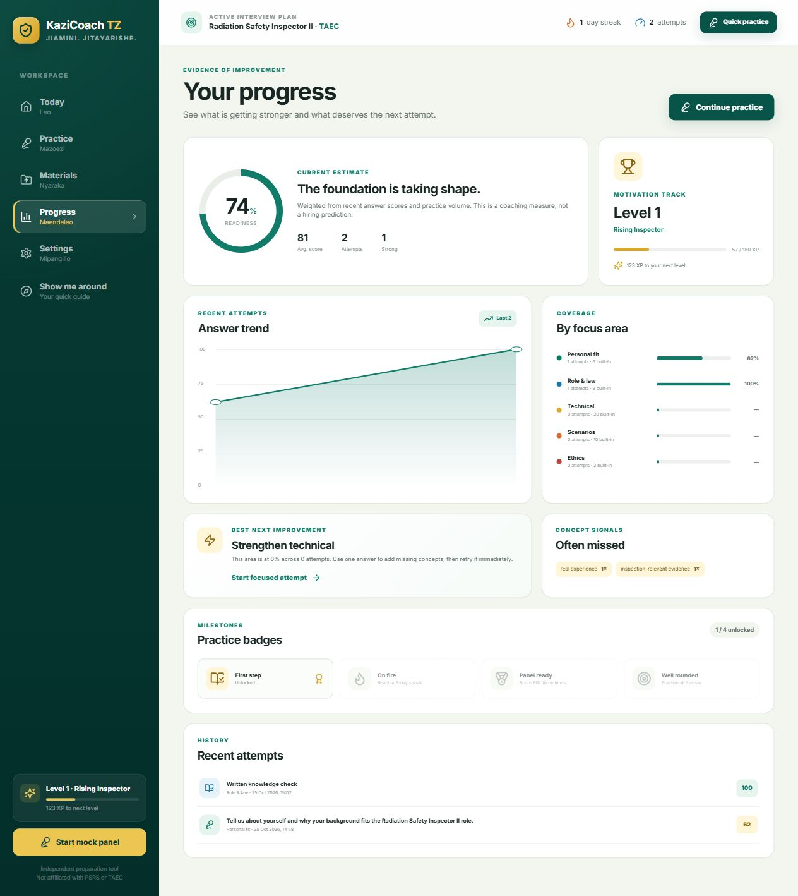
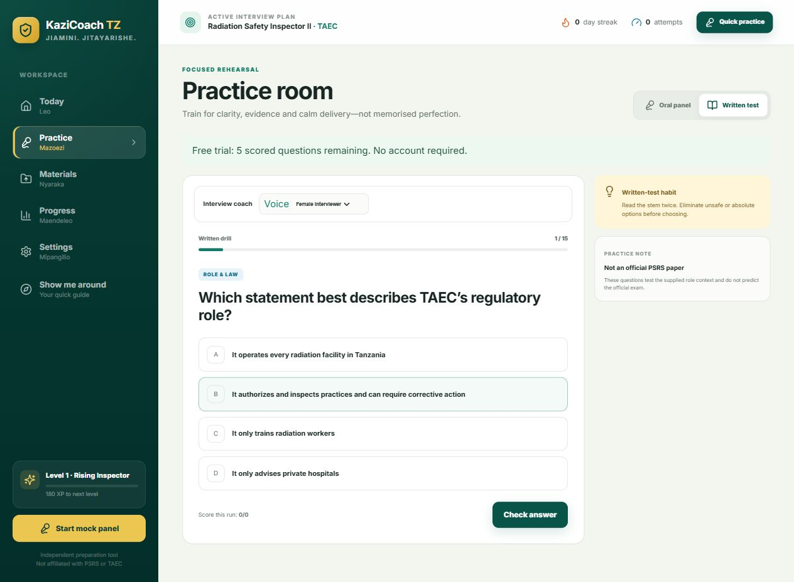

# Browser acceptance — 25 October 2026

## Scope and identity

Owner requested agent-executed tests. Target: staging deployment dee80769, application source f87924c. Account reference is msofecomputer@gmail.com; tests below used signed-out in-app-browser guest storage and synthetic content, without reading the owner's Chrome workspace. No cloud sync, hosted identities, database writes, paid services or SMTP requests were used. Two local-only synthetic attempts remain in this test browser; no browser data was cleared.

## Observed results

| Check | Result | Evidence |
| --- | --- | --- |
| Guest quick practice | Pass | Oral question opens without an account. |
| Typed answer feedback | Pass | Synthetic 58-word answer scores 62, feedback identifies missing concepts, 22 XP awarded, trial 5 to 4. |
| Progress and reload | Pass | Score 62 and one attempt persist after reload. |
| Guided navigation | Pass, sampled | Today, Materials and Practice steps navigate to the real views. Close returns to original Progress view. No trial use from browsing the guide. |
| Mobile layout | Pass, sampled | 390x844 viewport presents mobile navigation; tour dialog width 375.2px within the viewport, page scroll width 375px. Emulation only, not physical phone acceptance. Viewport reset after test. |
| Missing written selection | Pass | Check answer displays Choose one answer before checking; no attempt recorded. |
| Written scoring | Pass | Option B records 100, explanation appears, options disabled, trial 4 to 3, total 57 XP. |
| Both modes persist | Pass | Reloaded Progress shows two attempts, scores 62/100, average 81 and 57 XP. |
| Guest privacy boundary | Pass for UI | Settings still shows sign-in form and local summary of two attempts. No sync selected. This does not constitute a network-payload audit. |
| Written question content | **Fail on staging, fixed locally** | written-01 used oral-33's personal-experience prompt with regulatory-role choices. Corrected only its prompt and source; identifiers, answers, scores and stored data unchanged. |

## Fix and validation

Correct prompt: “Which statement best describes TAEC’s regulatory role?” Source confirmed against [TAEC Functions and responsibilities](https://www.taec.go.tz/pages/functions-and-responsibilities), Regulatory Function, on 25 October. Existing answer options and explanation retained. Official page supports authorization, inspections and corrective action; this was not a full content/legal audit of the question bank.

Added a bank integrity regression that checks written prompts are not copied from oral prompts, answer choices are unique and keys are valid integer indexes. All 98 tests in 13 suites, application/Functions types, ESLint, build, smoke and sanitized private artifact audit pass. Dependencies unchanged; npm ci not repeated. Database and local Auth integration suites not rerun for a static wording/test change.

Actual local browser confirms the corrected heading and matching choices:

Owner screenshots separately demonstrate password-update success, subsequent sign-in, persistence after refresh and sign-out persistence. These were owner-performed checks, not agent-entered credentials.

## Boundaries and next gate

This is a targeted browser acceptance pass, not production sign-off. Full offline disconnect/reconnect, microphone/audio quality, document imports, all 15 written questions, multiple account roles, cloud sync, premium/admin/MFA and physical phone acceptance were not tested in this pass. Remaining launch gates are in PRODUCTION_DEPLOYMENT_CHECKLIST.md. The content correction is local and not deployed by this test task.

Rollback: revert the small written-prompt/source and bank-test commit on feature/kazicoach-v2. No schema/data rollback is needed. Existing staging remains dee80769 until a separately authorized deployment.

## Authorized staging follow-up
Owner said proceed after the deployment gate. Deployed source bdc0d79 to staging as e66a8e75; frozen artifact .local-review/staging-artifact-bdc0d79. Exact-origin build, release audit and smoke passed again. Live page and three assets return 200, corrected stem is present in the served bundle, CSP matches the project, service worker is no-cache, disabled AI is 503/no-store. See deployed-http.json. Browser execution is now disabled in Work settings, so no new live visual pass is claimed. Existing local screenshot proves corrected rendering. No database or production changes. Compatible rollback is the retained f87924c artifact with matching Functions and staging bindings; this would restore the mismatched question. The earlier local-only status above is historical.
