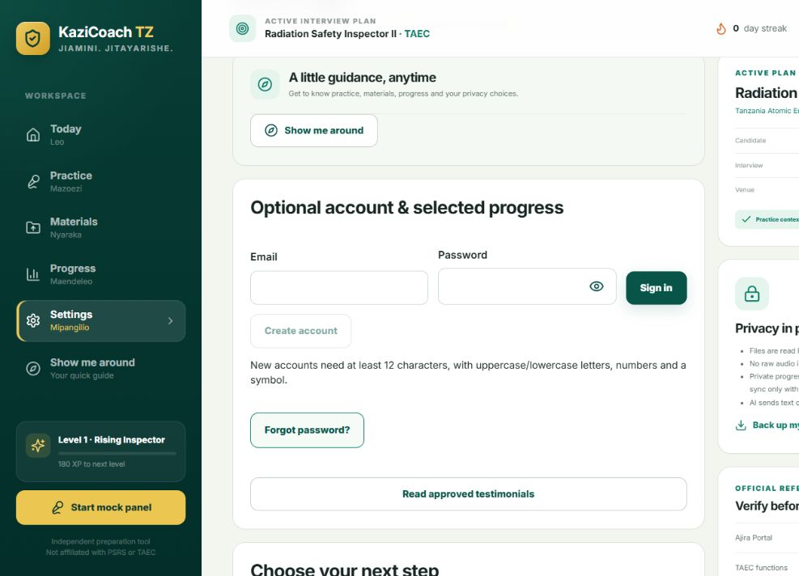

# Staging release — 25 October 2026

Owner explicitly authorized DEPLOY. Cloudflare account: msofecomputer@gmail.com. Only the existing staging preview was updated; no database, Auth configuration, production branch or billing changes.

- Reviewed source: `f87924c7a0435bb9c9735c8143e58731cb4661a0`, branch `feature/kazicoach-v2`.
- Pages project `kazicoach-tz`, deployment branch `staging`, deployment `dee80769`.
- Test URL: https://staging.kazicoach-tz-441.pages.dev/
- Frozen artifact: ignored `.local-review/staging-artifact-f87924c`; SHA-256 inventory in ignored `.local-review/deployment-evidence/staging-audit-2026-10-25.json`.
- Wrangler 4.152.0 uploaded static assets, headers, Functions bundle and routes successfully. Unrelated pre-existing untracked files were not included in the artifact.

## Verification

Source checkpoint: 97 unit tests passed, application/Functions type checking and ESLint passed. Exact-origin release configuration regression, hosted build, release audit and smoke passed again for deployment. Dependencies unchanged; database fixtures were not rerun against the populated hosted project.

Actual staging page and all three referenced JS/CSS assets returned 200. CSP permits only the correct Supabase connection in addition to self; frame denial is active. Service worker returns 200 with no-cache. Disabled AI endpoint returns 503 JSON with no-store.

Rendered browser initially had the old offline bundle; one normal refresh loaded the new build. Verified the password eye changes Show/Hide state using disposable text, clearing it restores masking; Forgot password opens the labelled form and focuses Account email. Empty sign-in is blocked by required-field validation. A deliberately invalid callback displays the actionable recovery alert and removes the callback parameters. No owner password or real token was entered, no recovery email was requested, and no hosted account was created/deleted. Persistent resend protection was verified locally in the linked diagnosis checkpoint, not by sending repeated live emails.

Real owner password replacement and subsequent login remain a private acceptance step. Production launch, MFA and operational gates remain in the deployment checklist.

## Rollback

Redeploy the retained compatible `.local-review/staging-artifact-6dfa287` from its reviewed source checkout with matching Functions and the existing staging bindings, using Pages project `kazicoach-tz` and branch `staging`. Do not deploy it to `release`, change the database, or reuse older defective/personal-content artifacts. Configuration and data do not follow a code rollback. Refresh an installed browser after the service worker updates. This would remove the latest recovery and UI fixes.
